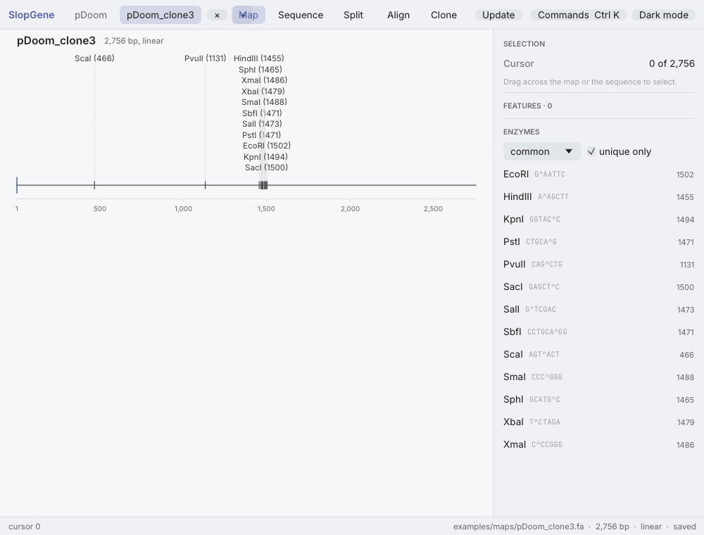

# SlopGene

SlopGene is a free, open-source and scriptable plasmid and sequence editor for Windows, macOS and Linux.
It draws plasmid maps, edits sequences, finds enzyme sites, designs primers, simulates PCR and digests, aligns sequences, checks sequencing results, and builds cloning constructs step by step on a bench.
Everything the desktop app does, the `slopgene` command line and its scripts do too, with JSON output for pipelines and AI agents.

## Download

<p>
  <a href="https://github.com/DebrajGhose/slopgene/releases/latest/download/SlopGene-windows-setup.exe"></a>
  <a href="https://github.com/DebrajGhose/slopgene/releases/latest/download/SlopGene-macos.dmg"></a>
  <a href="https://github.com/DebrajGhose/slopgene/releases/latest/download/SlopGene-linux.deb"></a>
  <a href="https://github.com/DebrajGhose/slopgene/releases/latest/download/SlopGene-linux.AppImage"></a>
</p>

Each button downloads the newest release and names its version.
Every download installs the desktop app and the `slopgene` command line: on Windows into `%LOCALAPPDATA%\SlopGene` without administrator rights, on macOS as `SlopGene.app`, on Debian and Ubuntu with `sudo apt install ./slopgene_<version>_amd64.deb`, and elsewhere on Linux as an AppImage that runs after `chmod +x` (it needs `libfuse2`, or the option `--appimage-extract-and-run`).
The installers are not code-signed, so the first start needs one extra step: on Windows, "More info" and then "Run anyway" in the SmartScreen dialog; on macOS 15 and later, "Open Anyway" under System Settings, Privacy & Security; on older macOS, right-click the app and choose Open.
The [releases page](https://github.com/DebrajGhose/slopgene/releases) holds older versions, plain archives of the two programs and `SHA256SUMS.txt`.

## See it work

Cutting GFP out of one plasmid and putting it into another.
A click on the gene and on Clone opens the protocol as a bench, a click on a card zooms into it, the two enzymes that cut nearest the gene are picked, and the join shows the new plasmid with its bases underneath.


Copying a part out by PCR instead, when no enzyme cuts near it.
The primers are designed for the part, and the enzymes chosen go on their tails, so the copy has the same sticky ends as the opened vector.


Checking a whole-plasmid sequencing read against its map.
Align adds the read, and every difference is marked on the map and in the bases, with its effect on the protein.



The plasmids and the read in these animations are made up and live in [examples/maps](examples/maps).

## What it does

SlopGene is two programs that share one Rust library, so a digest, a PCR or a map gives the same result in the app, on the command line and in a script.

| Area | Functions |
|---|---|
| Files | `.dna`, `.rna` and `.prot` (byte-for-byte round trips, the default for saving), GenBank, FASTA, JSON |
| Viewing and editing | circular and linear maps, both strands with translations and enzyme cuts, insert, delete, replace, invert, reverse-complement, set origin, topology, features, primers, undo |
| Enzymes | 581 commercial enzymes from REBASE, named sets, unique cutters, the sites that Dam, Dcm or EcoKI methylation blocks, digests with exact sticky ends and virtual gels |
| Primers | melting temperatures, pairing scores and design by Primer3's method, binding sites with mismatches |
| Cloning | PCR, restriction cloning, Gibson, NEBuilder HiFi and In-Fusion assembly, Golden Gate, and the enzymes that cut nearest a marked part |
| Protocols | constructions built step by step on a bench of small plasmids that zoom into full maps with the bases under them, with every junction checked |
| Alignment | sequencing reads or other sequences aligned to a map on either strand and through the origin, with the protein effect of each change and structural changes (deletions, insertions, duplications, inversions, dimers) |
| Analysis | ORFs in six frames, motif and protein search, mass, pI, feature detection from a library of your own maps |
| Scripting | a Rhai engine with every function above, from the command line or the app's console |

## The command line

The command line answers the questions a lab asks of its plasmids, and `--json` on any command gives the same answer to a program.

```
slopgene info "plasmids/**/*.dna"
slopgene sites pUC19.dna --unique
slopgene digest pUC19.dna -e EcoRI,PvuII --gel gel.png
slopgene design-primers pGFP.dna --range 419..1138 --fwd-tail TAAGCAGAATTC
slopgene align pDoom.dna pDoom_clone3.fa --show
slopgene verify "sequencing/*.gbk" --refs "maps/"
slopgene protocol new clone.json --vector pDoom.dna --insert pGFP.dna --cut-out GFP -e EcoRI,BamHI
slopgene protocol render clone.json -o clone.png
slopgene run examples/scripts/library_summary.rhai --arg dir=plasmids
```

`slopgene guide` prints a guide written for scripts and AI agents (also [docs/agent-guide.md](docs/agent-guide.md)), and [docs/scripting.md](docs/scripting.md) lists every script function.
On Windows the program is `%LOCALAPPDATA%\SlopGene\slopgene.exe`; add that folder to the user's PATH to run it by name.
On macOS it is `/Applications/SlopGene.app/Contents/MacOS/slopgene`, which `sudo ln -s` into `/usr/local/bin` makes a command.
The Debian package puts it in `/usr/bin`.

## The desktop app

A thin top bar holds the open documents, the view switch (Map, Sequence, Split), and the Align and Clone buttons, with the version in the window title.
The inspector on the right shows the selection, the selected feature and the lists of features, enzymes and primers.
The command palette (Ctrl+K, or ⌘K on macOS) reaches every action.
A click on the map or the sequence gives that view the keyboard: typed bases are inserted, Delete and Backspace remove the selection, Shift with the arrows extends it, and Ctrl+Z undoes with the cursor and selection put back.
New documents save as `.dna`, a document opened from GenBank or FASTA saves back to its own format when that format can hold all of it, and a file changed on disk reloads by itself when it has no unsaved edits, so an agent editing a file with `slopgene edit` shows up in the open window.

| Keys | Action |
|---|---|
| Ctrl+K | command palette |
| Ctrl+Shift+A | align sequences to this one |
| Ctrl+Shift+N | new cloning protocol |
| Ctrl+Shift+D | restriction digest with gel |
| Ctrl+O / Ctrl+S / Ctrl+Shift+S | open, save, save as |
| Ctrl+Z / Ctrl+Shift+Z | undo, redo |
| Ctrl+C / Ctrl+X / Ctrl+V / Ctrl+A | copy, cut, paste, select all |
| Ctrl+F / Ctrl+G | find, go to a position or range |
| Ctrl+1 / 2 / 3 | map, sequence, split view |
| Ctrl+J | script console |

### Comparing sequences

Align opens the alignment view of the open sequence and takes sequencing results or other sequences from files or from the other open documents.
The map draws each aligned sequence as a ring outside its circle: solid green where the two align, a thin red line where the aligned sequence lacks the map's bases, nothing where it gives no information, a labelled mark at each difference of a few bases, and a flag for bases only the aligned sequence has.
The pane beside the map sets the map's bases over the aligned sequence's bases under the features, with a coloured band and a label behind every difference and a bar above that draws the whole map and brings any part of it into view on a click.
A structural change of 50 bp or more takes one row in place of its bases.
The inspector gives the verdict, how many bases align, are missing or are extra, the colour key, and every difference with its protein effect, and a click on any of them selects those bases in both panes.
Green means aligned, red missing, orange a different base and violet bases only the aligned sequence has.

### Cloning protocols

A protocol builds a molecule step by step, such as cutting a gene out of one plasmid and putting it into another, and starts from the map: mark the part by dragging across the map or clicking a feature, then press Clone.
The protocol opens as a bench, where each plasmid heads a column as a small ring with the part turned to the top, its cut sits under it with the pieces pulled away, green pieces go on into the new plasmid, grey pieces are left over, and arrows carry the kept pieces to the join.
A click on a ring zooms into it: a plasmid into its full map, where a drag marks the part and a click on one of the enzymes shown nearest the part cuts there; a cut into its pieces, where a click keeps one; a join into the new plasmid with the insert shaded and the junctions marked.
Under every zoomed picture the molecule's bases appear with the same stretch selected, and a stretch selected there becomes the part.
"Copy the part out by PCR instead" adds a Copy card whose panel designs the primers by Primer3's method, aims them at a melting temperature of your choice, and puts the chosen enzymes' sites on their tails, so the trimmed copy has the vector's sticky ends.
The bench is built by dragging: a kept piece dropped on another plasmid cuts it with the piece's enzymes, keeps its backbone without 5' phosphates and adds the join, and every card's ••• menu holds the other changes.
A step chooses by itself only when one option fits; when an insert fits both ways round the join shows both plasmids and asks.
The join also shows the other plasmids its tube would make, such as the insert the other way round or an empty vector that kept its phosphates, and suggests checking colonies by digest or sequencing.
The panel on the right tells each step in plain words with the lab's term beside it, lists the enzymes nearest the part on each side with their distances and the ends they leave, and edits the step by hand.
A protocol saves as a `.json` file beside its maps; `slopgene protocol run` runs it, `slopgene protocol add`, `cut`, `keep`, `put`, `copy-out` and `primers` make the bench's changes, and `slopgene protocol render` draws the bench as a picture.

## Updating

The Update button in the top bar says whether a newer version is released, downloads it, checks it against the release's checksums, installs it and restarts SlopGene.
The command line does the same with `slopgene update --install`.
A copy built from the source tree is updated by building it again.

## Building from source

SlopGene needs Rust 1.95 or later, and `cargo build --release` in a clone of the repository builds both programs into `target/release`.
Linux needs a C compiler and linker such as `build-essential`, macOS the Xcode command-line tools, and Windows either the Visual Studio Build Tools or a MinGW-w64 toolchain with the MSVCRT runtime on the PATH.
`cargo test --workspace` runs the tests; three of them need files that are not in the repository and pass without checking anything when the files are absent.
[CONTRIBUTING.md](CONTRIBUTING.md) describes the tests, the rules the code follows and how a release is made, and [docs/architecture.md](docs/architecture.md) explains the design.

| Crate | Purpose |
|---|---|
| `crates/slopgene-core` | document model, file formats, algorithms, map layout |
| `crates/slopgene-script` | the Rhai scripting engine and its functions |
| `crates/slopgene-cli` | the `slopgene` command |
| `crates/slopgene-gui` | the `slopgene-gui` desktop app (egui) |
| `crates/slopgene-update` | finding, downloading and installing a newer version |

## Licence

SlopGene is free and open source, under either the MIT licence ([LICENSE-MIT](LICENSE-MIT)) or the Apache License 2.0 ([LICENSE-APACHE](LICENSE-APACHE)), at your option.

## Data and credits

- Restriction enzymes come from REBASE (Roberts RJ, Vincze T, Posfai J, Macelis D. REBASE, a database for DNA restriction and modification. Nucleic Acids Research).
- Genetic codes come from the NCBI translation tables.
- Melting temperatures, primer checks and primer design follow Primer3 (Untergasser A et al. Primer3, new capabilities and interfaces. Nucleic Acids Research 2012; Koressaar T, Remm M. Bioinformatics 2007), with the nearest-neighbour parameters of SantaLucia (1998). Primer3's thermodynamic model of hairpins and dimers is not used.
- The app bundles the Inter and JetBrains Mono fonts under the SIL Open Font License (`crates/slopgene-gui/assets/fonts`).

## Authors and funding

SlopGene is written by Claude and Debraj Ghose.
It was built with support from Anthropic's AI for Science program, which awarded the project Claude Science credits and compute credits from Modal.

## How SlopGene relates to SnapGene

The `.dna`, `.rna` and `.prot` files that SlopGene reads and writes are SnapGene's formats, so the two programs work on the same files.
SlopGene is a clean-room reimplementation.
Its file-format support comes from studying SnapGene documents and public parsers such as Biopython's.
Its feature list comes from SnapGene's interface text and sample project.
No SnapGene program code was disassembled or decompiled, and no SnapGene data (feature library, vector maps, sample files) is part of this repository.
