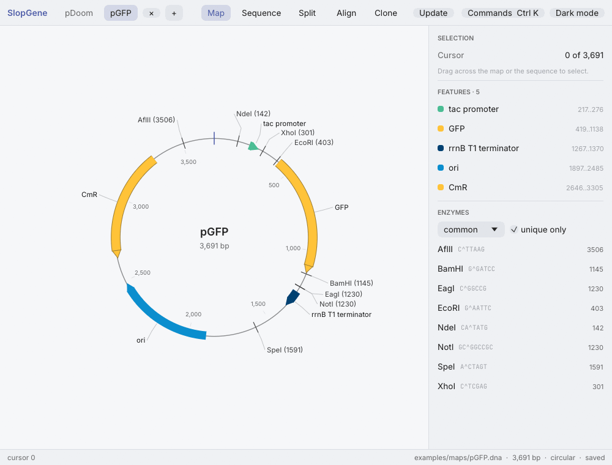
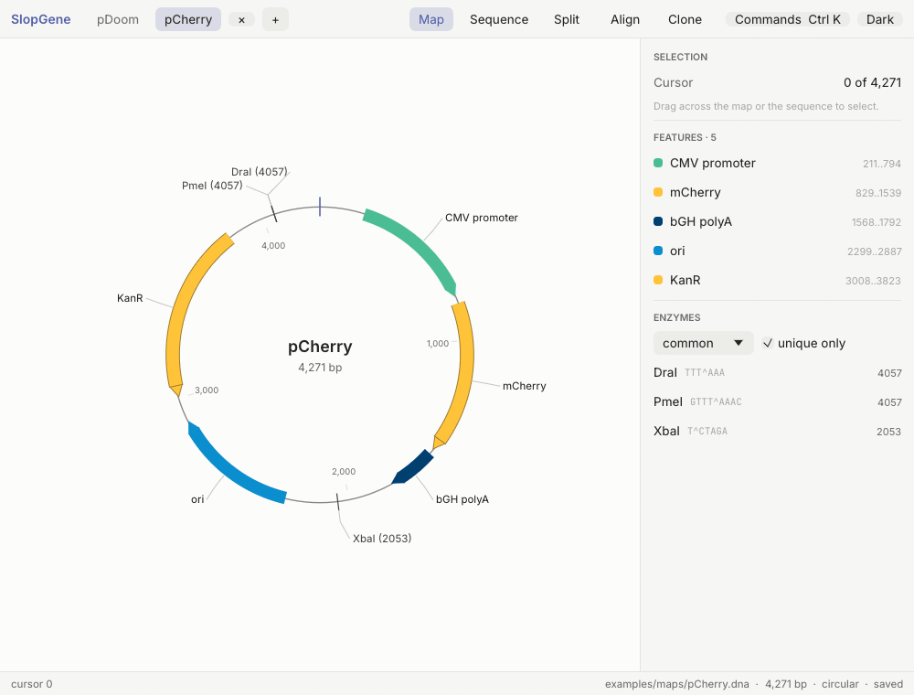

# SlopGene

SlopGene is a free, open-source and scriptable plasmid and sequence editor for Windows, macOS and Linux.
It draws plasmid maps, edits sequences, finds enzyme sites, designs primers, simulates PCR and digests, checks sequencing results, and builds cloning constructs step by step on a bench.
Everything the desktop app does, the `slopgene` command line and its scripts do too, with JSON output for pipelines and AI agents.

## Download

<p>
  <a href="https://github.com/DebrajGhose/slopgene/releases/latest/download/SlopGene-windows-setup.exe"></a>
  <a href="https://github.com/DebrajGhose/slopgene/releases/latest/download/SlopGene-macos.dmg"></a>
  <a href="https://github.com/DebrajGhose/slopgene/releases/latest/download/SlopGene-linux.deb"></a>
  <a href="https://github.com/DebrajGhose/slopgene/releases/latest/download/SlopGene-linux.AppImage"></a>
</p>

Each download installs the desktop app and the `slopgene` command line.
The installers are not code-signed, so Windows and macOS warn before the first start, and [The first start](#the-first-start) says which button to press.
Older versions, the plain archives and the checksums are on the [releases page](https://github.com/DebrajGhose/slopgene/releases).

## See it work

Cutting GFP out of one plasmid and putting it into another.
Click the gene on the map, press Clone, and the protocol opens as a bench.
A click on a card zooms into it, where the enzymes that cut nearest the part are picked, and the join shows the new plasmid with its bases underneath.



Copying a part out by PCR instead, when no enzyme cuts near it.
The primers are designed for the part, and the enzymes chosen go on their tails, so the copy has the same sticky ends as the opened vector.



The plasmids in these animations are made up, and they are in [examples/maps](examples/maps) to try the same steps with.

## Installing

The [releases page](https://github.com/DebrajGhose/slopgene/releases) has these files for each version.
Every installer puts both the desktop app and the `slopgene` command line on the computer.
The download buttons above fetch the newest installers under the names `SlopGene-windows-setup.exe`, `SlopGene-macos.dmg`, `SlopGene-linux.deb` and `SlopGene-linux.AppImage`.

| System | File to download | Notes |
|---|---|---|
| Windows 10 or 11 (x64) | `SlopGene_<version>_windows_x64-setup.exe` | Installs into `%LOCALAPPDATA%\SlopGene` without administrator rights, with a Start menu entry and an uninstaller |
| macOS 11 or later | `SlopGene_<version>_macos_universal.dmg` | One app for Apple silicon and Intel Macs: drag `SlopGene.app` onto Applications |
| Debian or Ubuntu | `slopgene_<version>_amd64.deb` | `sudo apt install ./slopgene_<version>_amd64.deb` adds a launcher under Science |
| Other Linux (x86_64) | `SlopGene_<version>_x86_64.AppImage` | Runs without installing after `chmod +x` |

The plain archives hold the two programs alone, for use without installing.
They are `slopgene_<version>_windows_x64.zip`, `slopgene_<version>_macos_universal.tar.gz` and `slopgene_<version>_linux_x86_64.tar.gz`.
`SHA256SUMS.txt` holds the checksum of every file.
An AppImage needs FUSE 2 (`libfuse2`) to start.
The option `--appimage-extract-and-run` starts it without FUSE.

### The first start

The installers are not code-signed, so Windows and macOS warn before the first start.

- **Windows:** SmartScreen says "Windows protected your PC". Choose "More info", then "Run anyway".
- **macOS 15 and later:** macOS refuses the first open. Open System Settings, then Privacy & Security, and choose "Open Anyway" next to SlopGene.
- **macOS 14 and earlier:** right-click `SlopGene.app`, choose Open, then Open again.
- **Any macOS:** `xattr -dr com.apple.quarantine /Applications/SlopGene.app` in Terminal clears the warning as well.

Signing would remove the warnings.
macOS signing needs an Apple Developer ID certificate and notarization by Apple.
Windows signing needs a code-signing certificate.
cargo-packager builds the installers and can sign them with both (its `macos` and `windows` settings).

### The command line

The command line sits beside the app.

| System | Where `slopgene` is | To run it by name |
|---|---|---|
| Windows | `%LOCALAPPDATA%\SlopGene\slopgene.exe` | Run once in PowerShell: `[Environment]::SetEnvironmentVariable("Path", [Environment]::GetEnvironmentVariable("Path", "User") + ";$env:LOCALAPPDATA\SlopGene", "User")`. Then open a new terminal. |
| macOS | `/Applications/SlopGene.app/Contents/MacOS/slopgene` | `sudo ln -s /Applications/SlopGene.app/Contents/MacOS/slopgene /usr/local/bin/slopgene` |
| Linux, from the `.deb` | `/usr/bin/slopgene` | Nothing to do |

### Updating

When it starts, SlopGene asks GitHub once whether a newer version has been released.
When there is one, an "Update to 0.3.0" button appears in the top bar.
It opens a dialog that says which file will be downloaded and what will happen on this computer, and "Download and install" does the rest: the file is downloaded, checked against the release's checksums and installed, and SlopGene starts again.
On Windows the installer runs by itself with a progress bar.
On macOS the programs inside SlopGene.app are replaced and the app is signed again.
On Linux the AppImage file is replaced, or the package is installed after the password prompt.
"Check for updates…" in the command palette looks at any time, and a checkbox in the dialog turns the check at start off.
The command line does the same with `slopgene update`, and `slopgene update --install` installs the newer version.
A copy built from the source tree is not updated this way: build it again.

## What it does

SlopGene is two self-contained programs that share one Rust library, so a digest, a PCR or a map gives the same result everywhere.

- `slopgene-gui` is the desktop app: plasmid maps, the sequence, features, primers, enzymes and cloning tools.
- `slopgene` is the command line: every analysis and edit, with JSON output for scripts and AI agents.

| Area | Functions |
|---|---|
| Files | `.dna`, `.rna` and `.prot` (byte-for-byte round trips, the default for saving), GenBank, FASTA, JSON |
| Viewing | circular and linear maps, sequence view with both strands, translations and enzyme cuts |
| Editing | insert, delete, replace, invert, reverse-complement, set origin, topology, features, primers, undo |
| Enzymes | 581 commercial enzymes from REBASE, named sets, unique cutters, digests with exact sticky ends |
| Primers | nearest-neighbour Tm, binding sites with mismatches, dimer and hairpin checks, primer design |
| Cloning | PCR, restriction cloning, Gibson / HiFi / In-Fusion assembly, Golden Gate, and the enzymes that cut nearest a marked part |
| Protocols | constructions built step by step on a bench of small plasmids that zoom into full maps with the bases under them (open, cut, copy by PCR, keep, dephosphorylate, flip, join), with every junction checked |
| Analysis | ORFs in six frames, motif and protein search, virtual agarose gels, mass, pI |
| Alignment | align sequencing reads or other sequences to a map (any rotation or strand) and show the aligned bases, with protein effects of each change and structural changes (deletions, insertions, duplications, inversions, dimers) |
| Annotation | detect features from a library of your own annotated maps |
| Scripting | an embedded Rhai engine, from the command line or the app's console |

## Getting started

Open a file in the app:

```
slopgene-gui pUC19.dna
slopgene view pUC19.dna          # the same, from the command line
```

Ask questions from the command line:

```
slopgene info "plasmids/**/*.dna"
slopgene sites pUC19.dna --unique
slopgene digest pUC19.dna -e EcoRI,PvuII --gel gel.png
slopgene verify "sequencing/*.gbk" --refs "maps/"
slopgene align pUC19.dna read.gbk --show
slopgene excise donor.dna --feature GFP --vector pUC19.dna
slopgene protocol new clone.json --vector pUC19.dna --insert donor.dna --cut-out GFP -e EcoRI,BamHI
slopgene render pUC19.dna -o pUC19.png
```

Add `--json` to any command for machine-readable output.
`slopgene guide` prints a guide written for scripts and AI agents (also in [docs/agent-guide.md](docs/agent-guide.md)).

Run a script over many files:

```
slopgene run examples/scripts/library_summary.rhai --arg dir=plasmids --arg recursive=true
```

[docs/scripting.md](docs/scripting.md) describes the scripting language and its functions.

## The desktop app

The app keeps its controls out of the way.
A thin top bar holds the open documents, the view switch (map, sequence or both), and the Align and Clone buttons.
The inspector on the right shows the selection, the selected feature and the lists of features, enzymes and primers.
The command palette (Ctrl+K, ⌘K on macOS) reaches every action, grouped under File, Tools, Edit, View and Export.

| Keys | Action |
|---|---|
| Ctrl+K | command palette |
| Ctrl+Shift+A | the alignment view, as the Align button opens it |
| Ctrl+Shift+N | new cloning protocol |
| Ctrl+O / Ctrl+S / Ctrl+Shift+S | open, save, save as |
| Ctrl+Z / Ctrl+Shift+Z or Ctrl+Y | undo, redo |
| Ctrl+C / Ctrl+X / Ctrl+V | copy, cut, paste bases |
| Ctrl+A | select the whole sequence |
| Delete / Backspace | delete the selection |
| Ctrl+F / Ctrl+G | find, go to position or range |
| Ctrl+1 / 2 / 3 | map, sequence, split view |
| Ctrl+J | script console |
| Ctrl+Shift+D | restriction digest with gel |

On macOS, ⌘ takes the place of Ctrl.

A click on the sequence or the map gives that view the keyboard.
Type bases in the sequence view to insert them.
Backspace and Delete remove bases there, and Shift with the arrows extends the selection.
In the map, Delete and Backspace remove the selected bases.
Undo, redo, copy, cut, paste and select all work in both views and after a click in the inspector.
A text field keeps these keys for its own text while you type in it.
Undo puts the cursor and selection back as they were, and a burst of typing undoes in one step.
New documents save as `.dna` files, which keep every annotation.
A document opened from FASTA or GenBank saves back to its own file when that format can hold all of it.
When it cannot, as with features added to a FASTA file, Save writes a `.dna` file beside the original and leaves the original as it was.
Files that change on disk reload by themselves when they have no unsaved edits.
An agent editing a file with `slopgene edit` therefore shows up in the open window.

### Comparing sequences

The Align button in the top bar opens the alignment view of the open sequence (Ctrl+Shift+A does the same).
It aligns sequencing results or other sequences to it, from files or from the other open documents.
The map on the left draws the open sequence as its circle and each aligned sequence as a ring outside it, or as a line under a linear map.
The ring shows what the aligned sequence has of the map.
It is a solid green band where the two align and a thin red line where the aligned sequence lacks the map's bases.
There is no ring where the aligned sequence gives no information, as beyond the ends of a Sanger read.
A difference of a few bases is a mark across the ring, labelled with its position and change, such as `2,501 G>T`.
Bases that only the aligned sequence has stick out of the ring as a flag.
The pane in the middle sets the open sequence's bases over the aligned sequence's bases, with the features above them.
A coloured band lies behind every difference, and a label under it says what changed.
Above the rows, a bar draws the whole map in the ring's colours and outlines the part the rows show.
A click on the bar brings that part into view.

| Colour | Meaning |
|---|---|
| Green | aligned: the aligned sequence has these bases of the map |
| Red | missing: the aligned sequence lacks these bases (a deletion, or bases replaced by other sequence) |
| Orange | different bases (a substitution, or a stretch turned round) |
| Violet | bases only the aligned sequence has (an insertion, a duplication, or the sequence in place of replaced bases) |

A structural change of 50 bp or more takes one row in place of its bases, which says in both sequences' names what changed.
The inspector on the right lists the aligned sequences with their verdicts.
For the one shown, it gives how many of the map's bases align, how many are missing and how many bases only the aligned sequence has.
It then lists the colour key, the structural changes and the differences with their protein effects.
It ends with the alignment method and its scores.
Clicking a mark, a difference or a base selects those bases and brings them into view in both panes.
An edit to the open sequence aligns everything again.

### Cloning protocols

A protocol builds a molecule step by step, such as cutting a gene out of one plasmid and putting it into another.
It starts from the map.
Mark the part to cut out by dragging across the map or clicking a feature.
Then press Clone, which sits in the inspector's Selection section, the map's right-click menu, the top bar, the `+` menu and the command palette.
Ctrl+Shift+N does the same.
A region marked on the other open plasmid becomes the part that the insert replaces.

The protocol opens in a tab of its own, laid out as a bench.
Each plasmid heads a column as a small ring.
The part being worked on is turned to the top of its ring.
Under each plasmid sits its cut, where the ring breaks at the cuts and the pieces pull away from it.
Green pieces go on into the new plasmid, and red pieces are left over.
Arrows carry the kept pieces down to the join, which draws the new plasmid.
Each card says what its step does: Start, Cut, Copy or Join.
A dephosphorylation rides on its arrow as a label.

A part can be copied out by PCR instead of cut out.
The menu of a plasmid's card or its cut's offers "Copy the part out by PCR instead", and the lane gains a Copy card between the plasmid and its cut.
The Copy card draws the PCR product as a bar: the copy in green, with the primers' tails in grey at its ends.
The panel designs primers for the part and lists the enzymes that can go on their tails, with those that open the vector once first.
One click per primer puts an enzyme's site on its tail.
The cut after the PCR trims the tails, so the piece has the sticky ends the vector has.
The vector's enzymes carry over to the tails, and new tails carry over to the vector.
The primers are designed anew on each run until "Keep these primers" writes them into the protocol, so they stay as they are when a map changes.
Each primer has a Copy button, and the other pairs designed are a click away.
"Cut the part out instead" turns the lane back.

A click on a ring zooms into its detailed view, and "All steps" or Escape zooms back out.
A plasmid zooms into its full map, which is where its cut is chosen.
Drag across the map to mark the part, or click a feature.
The enzymes that cut nearest the part then appear on the map.
A click on one of them cuts there.
The chosen cuts are bold and drawn in the accent colour, and a second click takes one off.
A cut that has no pieces yet zooms into its plasmid's map in the same way.
A cut with pieces zooms into them at full size, where a click on a piece keeps it.
A join zooms into the full map of the new plasmid, with the insert shaded and the junctions marked.
Under each zoomed picture, the molecule's bases are shown as a sequence view with the same stretch highlighted: the part on a plasmid, the piece kept in a cut, the insert in a join.
A stretch selected in either view shows in both, and one selected under a plasmid becomes the part.
The Sequence button hides the bases and brings them back, and the handle between the two moves the split.

The bench is built up by dragging.
Drag a cut's green piece onto another plasmid to put the piece into it.
That plasmid is then cut with the piece's enzymes, its largest piece is kept as the backbone without its 5' phosphates, and a join of the two follows.
Drag a green piece onto a join to add it to that new plasmid.
While a piece is carried, every card that takes it lights up, and the card under the pointer says what letting go does.
The "Add another plasmid" place starts a new column with a map to cut a piece from.
The "Put it into a plasmid" place chooses the vector when the bench has none yet.
Every card has a ••• button that opens the same menu as a right-click.
The menu holds the step's other changes, such as taking a plasmid out with all its steps, clearing a cut's enzymes, or taking a piece out of a join.
A click on a "no 5' phosphates" label shows that step, and a right-click on it leaves the step out.
The status bar says what each change did, and Ctrl+Z undoes it.

The panel on the right tells the step shown in plain words, with the lab's term beside it.
For a cut, it lists the enzymes that cut nearest the part on each side, nearest first.
Pick one enzyme before the part and one after it.
Each enzyme gives its distance from the part, and hovering it tells the end it leaves and how often it cuts.
A tick marks an enzyme whose end can join the piece on the other side of the join.
The insert's enzymes carry over to the vector until the vector gets enzymes of its own.
The enzymes can also be typed, and the enzyme set can be changed.
`slopgene excise` and the script functions `nearest_cuts` and `excision` give the same lists from the command line.

A step chooses by itself only when one option fits.
When an insert fits both ways round, the join shows both plasmids side by side, and Use this settles it.
A failed step says why and what would fix it.
Ligation needs a 5' phosphate at every junction, so a dephosphorylated vector cannot close on itself.

A join also shows the other plasmids its tube makes.
Ligase joins every pair of ends that fit.
The plasmid with the insert the other way round therefore forms even after a direction is chosen.
A backbone that keeps its 5' phosphates can close on itself without an insert.
Several inserts can go in fewer or in another order.
The join's card draws these plasmids smaller and in grey after a thin line.
The words under each one say "also forms" and how it differs.
The card's status line counts them.
The zoomed join lists them in a strip beside the new plasmid.
"Use this instead" makes one of them the product when it holds every piece in order.
A backbone closed on itself offers to remove its 5' phosphates.
A colony can carry any of these plasmids.
The panel therefore suggests checking colonies by a digest or by sequencing.
The panel's last section edits the step by hand: its name, inputs, enzymes, pick criteria, orientations and note.
The up and down arrows walk through the steps.
Open as a tab opens a map or the new plasmid as a sequence of its own.
A protocol takes a map from its open tab when there is one, so unsaved edits count.
It saves as a `.json` file beside its maps, and `slopgene protocol run` runs the same file from the command line.
The command line makes the bench's changes too, with `slopgene protocol add`, `cut`, `keep`, `put`, `take-out`, `remove-map`, `leave-out`, `dephosphorylate`, `turn`, `copy-out`, `cut-out` and `primers`.
Scripts make them with `protocol_add`, `protocol_cut`, `protocol_put` and the other functions in [docs/scripting.md](docs/scripting.md).

## Building from source

SlopGene needs Rust 1.95 or later (the desktop app's egui 0.37 sets this minimum).
Clone the repository and build both programs:

```
git clone https://github.com/DebrajGhose/slopgene.git
cd slopgene
cargo build --release
```

The programs land in `target/release/`.
On Windows with the GNU toolchain, a MinGW-w64 toolchain with the MSVCRT runtime must be on the PATH (for example WinLibs), because the Windows API crates need `dlltool` and `as`.
With Visual Studio Build Tools the default MSVC toolchain needs nothing extra.
On Linux the build needs only a C compiler and linker, such as Debian's `build-essential`.
The desktop app loads the system's Wayland or X11 libraries and GPU drivers when it starts.
On macOS the Xcode command-line tools provide the compiler and linker.

Run the tests with `cargo test --workspace`.
Three of the tests need files that are not in the repository, and they pass without checking anything when the files are absent.
[CONTRIBUTING.md](CONTRIBUTING.md) describes them.

## Layout of the code

| Crate | Purpose |
|---|---|
| `crates/slopgene-core` | document model, file formats, algorithms, map layout |
| `crates/slopgene-script` | the Rhai scripting engine and its functions |
| `crates/slopgene-cli` | the `slopgene` command |
| `crates/slopgene-gui` | the `slopgene-gui` desktop app (egui) |
| `crates/slopgene-update` | finding a newer version on GitHub, downloading it and installing it |

[docs/architecture.md](docs/architecture.md) explains the design.

## Contributing

[CONTRIBUTING.md](CONTRIBUTING.md) explains how to build and test SlopGene, the rules the code follows, and how a release is made.

## Licence

SlopGene is free and open source.
You may use, copy, change and share it under either the MIT licence ([LICENSE-MIT](LICENSE-MIT)) or the Apache License 2.0 ([LICENSE-APACHE](LICENSE-APACHE)), at your option.

## Data and credits

- Restriction enzymes come from REBASE (Roberts RJ, Vincze T, Posfai J, Macelis D. REBASE, a database for DNA restriction and modification. Nucleic Acids Research).
- Genetic codes come from the NCBI translation tables.
- Melting temperatures use the nearest-neighbour parameters of SantaLucia (1998) and SantaLucia and Hicks (2004).
- The app bundles the Inter and JetBrains Mono fonts under the SIL Open Font License (`crates/slopgene-gui/assets/fonts`).

## Authors and funding

SlopGene is written by Claude and Debraj Ghose.
It was built with support from Anthropic's AI for Science program, which awarded the project Claude Science credits and compute credits from Modal.

## How SlopGene relates to SnapGene

The `.dna`, `.rna` and `.prot` files that SlopGene reads and writes are SnapGene's formats, so the two programs work on the same files.
SlopGene is a clean-room reimplementation.
Its file-format support comes from studying SnapGene documents and public parsers such as Biopython's.
Its feature list comes from SnapGene's interface text and sample project.
No SnapGene program code was disassembled or decompiled, and no SnapGene data (feature library, vector maps, sample files) is part of this repository.
SnapGene is a trademark of Dotmatics.
SlopGene is not affiliated with SnapGene or Dotmatics.
